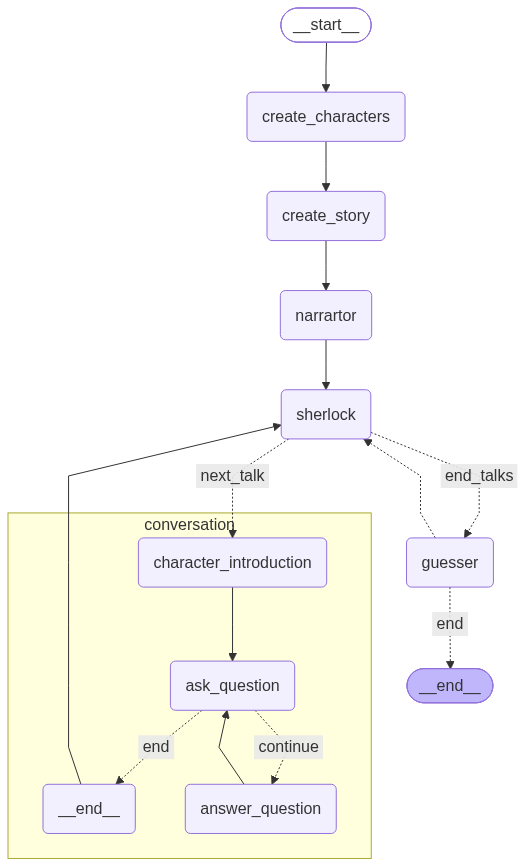

# Murder Mytery Game Description

"Murder Mytery" is an interactive text-based detective games by Large Language Model(LLM).

In this engaging experience, a human player steps into the shoes of Sherlock Holmes to solve procedurally generated murder mysiteries. The game create unique scenarios each time you play.

## Architeture

We use two LangGraph to build the infinite game mechanics for Muder Mystery Agent
1. Game Loop Graph: This is the main Graph which orchestrage the game creation  and the game loop. This Graph is responsible for:
    + Create the game character/NPC.
    + Creating the storyline.
    + Introducing player/user to game 
    + Game Mechanics of character game (through Conversation Sub Graph) and Guessing the Killer.
2. Conversation SubGraph: 
    
    This is the SubGraph which orchestrate  the infinite Conversation Mechanics of the game. This graph allow Player/User to interview the different Characters in the game to identify the Killer. 

    The Graph also support Sherlock AI Assitant that can interview process and assist the Players/User with their investigation. The AI assistant had access to Clues which can aid the Player with their investigation.

# Methob:
Systen have 2 plases:

Game Setup:
 1. User inputs is an initial enviroment string, amount players, and the number of guesses the investigator can make,
 2. Plot and character backtory ganerate by LLM
 3. One character is set as the murderer and the others are innocent

 Game Loop: Human/LLM Agent acts as the investigator. It can make 2 actions: talk to characters in the scene and guess which of the characters is the killer.

Talking to characters maintains a conversation with an LLM Agent with memory.

The entire process is orchestrated using LangGraph, which manages the flow of information between different components and ensures that each step builds upon the previous ones.

## Understanding of our Approach

Below is step-to-step guide to out thought process of Muder Mystery Agent
 

1. Setting the Stage:
2. Creating the cast (character background)
3. Writing story 
4. Design Interaction
5. Making it Dynamic
6. Player Experience

