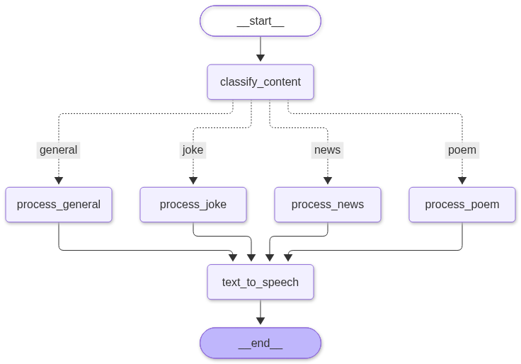
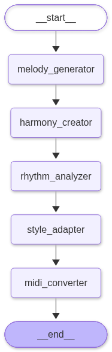
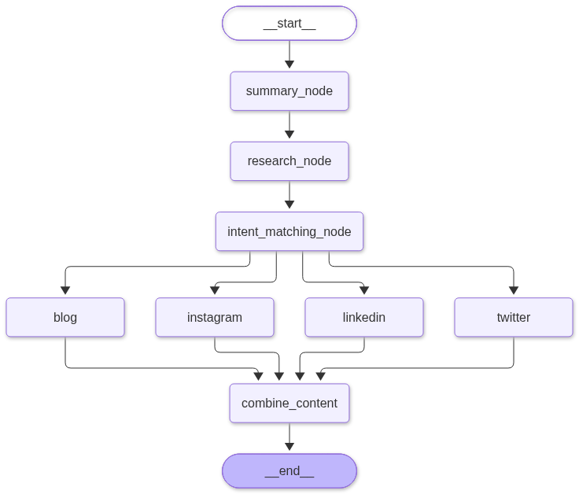
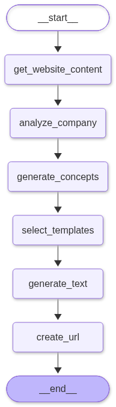

# GIF animation generator
Demontate the creation of a GIF animation generator that leverages the power of the large language model(LLMs) and image generation AI.

By combining LangGraph for workfow management ```gpt-4.o-mini``` for text generator and ```gpt-image-2.5-flare ``` for image creation.


This project aims to show how various AI technologies can intergated to create seamless workflow that transform single prompt into a dynamic visual story.


## Methob:

The GIF generation process follows these hight-level step:
1. Character/Scene Description: Base on the user's input query, The system generates a detailed description of the main character or scene.
2. Plot Generation: Using the character discription and initial query, a 5 step plot is created, 
3. Image prompt creation: For each step of the plot, a specific image promprs is generated, ensure consistancy across the frames.
4. Image generation: Create image based on user prompt.
5. GIF assembly: The generation image are compile into a GIF animation


# Text to speed
This project aim to create a versatile TTS agent that goes beyond simple text to speech conversion by uderstand and adapting to different  type of content.


## Key Component:
1. Content classification: Utilizes OpenAI model to categorize input text
2. Content processing: Applies specifivc process base on context type(general poem, new, or joke)
3. Text to Speech conversion: 
4. Workflow

## Methob:
This Text-to-Speech operator through the following hight-lever-steps:
1. Text-input: The system recieve a text input from the user
2. Content classification: input classifies into four categories: generate, poem, new, joke
3. Content-specific-processing: base on classification, the text undergoes specific process;
    - Generation: text remain unchange
    - Peom rewritten for then enchanced poetic quality
    - News is reformatted into a formal news anchor style
    - Jokes are refined for humo
4. text-to-speech coversion: Process text conver to speed and approriate voice for it content type
5. Audio output: 





# Music compositor
This system generate musical base on user input, leveraging varios components to create melody, harmony, rhythm, and sytle adaption.

Create music programatically is a fascinating intersection of AI and artictic expression. This project aims to explore how language model and graph-based workfow can used to generate conherent mucical species, provide a unique approach AI-assited music composition.

## Methob:
1. The workflow begins by generating a melody based on user input.
2. Then to create harmony to complement the melody.
3. A rhythm is analyzed and suggested for the melody  and harmony.
4. The composition are update to the specific music style.
5. Final composition is converted to MIDI format.
6. The generated MIDI style can be played back using pygame.





# Content Generate 
The agent is design to tranform input text into platform-optimate content across multi social media channels, incorprating research insights and maintaining brand consistency throughout the process.

Content intelligence automatic this process by:
+ Analyzing and sumarizing input content
+ Condusting researcher to enhance content quality
+ Generating specific content while maintain brand voice.
+ Managing complex workflow through structure a graph approach


### Data flow:
1. Input text enter the summary node to inital processing.
2. Summarized content move to research node for enhancement.
3. Intent matching destribute content for platform-specific node
4. Each platform node generate optimized content
5. Content is combine then return results




# MEME business generate

Demonstrates the creation of business meme generator that leverages LLM and memegen.link API.

This project aim to showcase how AI technologies can be interated to created the workflow that analyzes a company's online presence and automatically generates relevant, brand-aligned meme.

### Method:
The meme generate following the high lever steps:

1. Website Analysis:
    - Fetches and analyses company website content
    - Extract key information about brand tone, target content, and value proposition

2. Context Generation:
    - Create a structure company context generate:
        + Brand tone of voice
        + Target audience
        + Value proposition
        + Key product/ service
        + Brand presonalist traits
3. MeMe generation:
    - Generate multiple meme concept base on company context.
    - Each concept include:
        + Main massage/joke
        + Intended emotional response
        + Audiance relevance

4. Template selection:
    - Create contextual approprite template from memegen.link
    - Matches context with approprite template based on context

5. Text Generation:
    - Create contextual approprite for each meme.
    - Ensure alignment with brand voice and massage.
6. Meme Assembly:
    - Combines select templates with generate text
    - Create final meme URLs using MEMEgen.link


