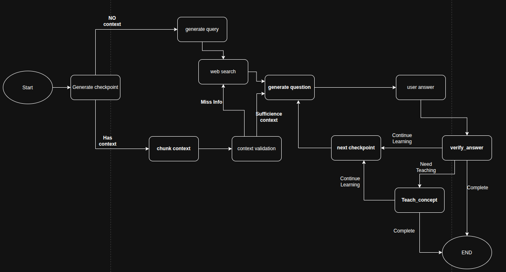

# Feynman learning agent

Feynman Technique is a method of learning that require you teach a concept in simple terms, as if explaining it to a child 

Structured learning agent implemented using LangGraph. This system guides learners through a sequence of defined but customzable checkpoints,
verifying understanding at each step and providing Feynman style teaching when needed.

In tradditional education setting, access to personalized 1:1 is often limited by cost and availability. This project aim to democractive personlized leaning by create AI tutor that can:

+ Provide individual attention and feedback 24/7
+ Use your own notes and web-retrieved content as context
+ Offer paitent, simple explanation of context topic

### Key components
1. Learning State graph: Orchestrates and the sequential learning workflow
2. Checkpoint System: Define structure learning miletones
3. Web Search Intergration: Dynamically retrieves  relevant learning meterials
4. Context processing: Chunking and processes context materuals
5. Question Genneration: Created checkpoint-specific verfication quesions
6. Understand Verification: Evaluated learner comprehensive with a clear threahold(70%)
7. Feynman teching: simplify complex concepts when understading is insufficient

### Methob
The system follows a structure learning cycles:
1. Checkpoint Definion: Generate learning milestone with clear success criterial
2. Context Building: Proccessed student-provided material or retrieval relevant web content.
3. Context validation:
    + Validation context base on checkpoint criterial
    + Perform additional web searches if context dosen't meet checkpoint requirments
4. Embedding storage: Stores embedding retrieving only relevant chunk during verification
5. Understanding verification:
    + Generate checkpoint-specific question
    + Evaluaion response againts at 70% threshold
    + Provide detail feedback
6. Progressive learning:
    + Advanted to the next checkpoint where understanding is verified
    + Provide Feynman-style explanation when needed.

