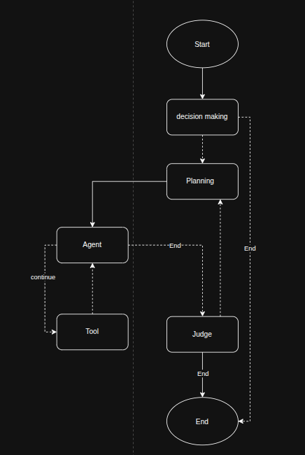

# Intelligent Research assistant
Implements intelligent research assistant that helps users navigate, understand and analyze scientific literature using Langgraph and language models.

Research literature represens a significant time invesment in R&D, 
While thorough literature is crucial for advancing science and technology

Key challenges include:
+ Inefficient search processes across fragmented database ecosystems
+ Complex task of synthesizing and connecting findings across multiple papers
+ Resource-intensive maintenance of comprehensive literature reviews
+ Ongoing effort required to stay current with new publications

### Key Components:
1. State Drive workflow engine:
    + StateGraph Architeture: Five node system for orchestrated search
    + Decision Making Node: Query intent analysis and making
    + Planning Node: Research strategy formulation
    + Tool Execution Node: Paper retrieval and processing
    + Judge node: Quality validation and improvement cycles
2. Paper processing integration:
    + Source interation, CODE API for Comprehensive paper access
    + Document processing, PDF content extraction, Text structure preservation

3. Analysis workflow:
    + State-aware processing pipeline
    + Multi step validation gate
    + Quality-focused improvement cycles
    + Human in the loop validation option

   