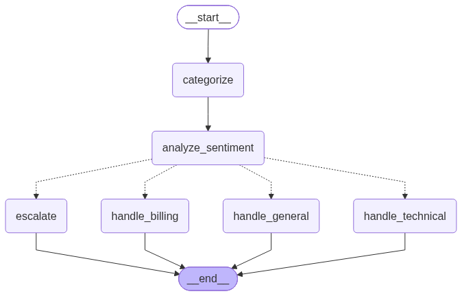

# Custom support agent

Demonstrate how to use intelligent customer support agent by using Langgraph, a powerful tool for building complex language model workflow. The agent is designed to categorize customer queries, analyze sentiment, and provide approriate response or escalate issue when necessary.

Automating the inital staged of customer interaction can significantly reduce response times and improve customer satisfaction. This project aim to showcase how to advanced languare model and graph base workflow can be combined and create satisfication support system that can handle a variety of customer inquiries.

## Key components:
1. State Management: Design and manage the state of each customer interaction
2. Query Categorization: Classfying customer queries into Technical, Billing or General categories
3. Sentiment Analyzer: Determining the emotiona tone of customer queries.
4. Response Generation: Create appropriate response base on the query category and sentiment
5. Escalation Mechanism: Automatic esxalation queries with native sentiment to human agents
6. Workflow Graph: Utilizing LangGraph to create flexible and extensible workflow

## Methob detail:
1. Initialization: set up enviroment and necessary libraries
2. State defination: Create structure to hold query infotmation, category, sentiment, and respone
3. Node fuction: Implement separate function for categorization, sentiment analysis and response generation
4. Graph Contruction: Use Stategraph to determine workflow, add nodes, edge to represent the support process
5. Conditiona Routing: Implement logic to route query based on their category and sentiment
6. Workflow Complication: Complie the graph into the an executable application
7. Execution: Process cutomer queries through the workflow and retriecal results 

# Essay grading system
The system implement Essay grading system using langgraph and LLM. This system evaluation essay based four criteria: Relevance, Grammar, Structure, depth of analysis.

This implementation aims to demonstrate how LLM and graph base knowledge can combine to create sophiticated grading system

## Key components:
1. State Graph: define workflow graph of gradding process
2. LLM Model: provide underlying language understanding and analysis
3. Grading Functions: Separate functions for each evaluation critetion
4. Conditional Logic: Determine flow grading process base on intering score

## Methob
The system flowing step to step to grade essay;
1. Content Relevance: Assesses how well essay addresses the given topic
2. Grammat Check: Evaluation the essay's language usage and grammatical correcteness
3. Structure analysis: Examines the orgination and flow the idea in the essay
4. Deplt analysis: Gauges the level of critical thinking and insight presented

